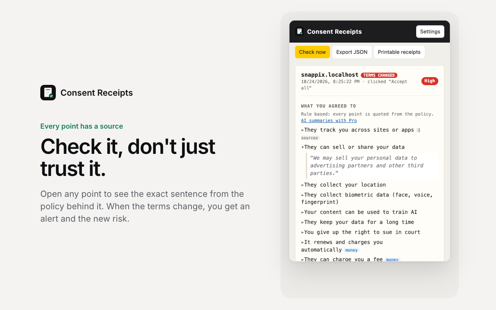
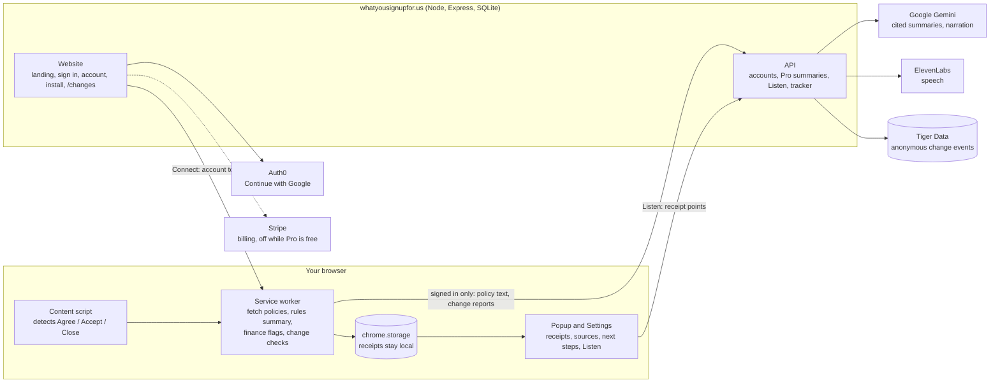

# Consent Receipts

[](https://gitdiagram.com/b-3llum/hackpsu26?utm_source=readme&utm_medium=badge)
[](LICENSE)

**Know what you signed up for.** Consent Receipts is a Chrome extension that keeps a plain words receipt every time you click Agree, links every risk to the exact sentence in the policy, and tells you when the terms change.

[Website](https://whatyousignupfor.us) · [Install](https://whatyousignupfor.us/install) · [Terms change tracker](https://whatyousignupfor.us/changes) · [Privacy](https://whatyousignupfor.us/legal/privacy)



## Features

- **Receipts for every consent.** Clicking Agree, Accept all, Allow, an "I agree" box, or closing a cookie notice saves the site, the time, the button, the policy links, and your cookie choices. Works with OneTrust, Cookiebot, TrustArc, and Quantcast banners, including banners inside iframes.
- **Cited summaries.** Every point in a summary opens to the policy sentence it came from, with a Low, Medium, or High risk score. Negation aware rules ("we never sell your data" is not flagged) run locally; AI summaries add a trust score and can never hide a rule based finding.
- **Finance mode.** Flags fees, late payments, interest rate changes, overdraft, minimum balances, and auto renewals in bank, loan, and subscription terms.
- **What to do next.** Opt out of data sale or AI training, opt out of arbitration, cancel before a renewal, or request deletion, each with a drafted request you can copy.
- **Change alerts.** Saved policies are rechecked daily or on demand; you get a notification with the sentences added and removed and the risk before and after.
- **Listen.** A short spoken summary of any receipt: Gemini writes it from the cited points, ElevenLabs reads it.
- **Terms change tracker.** A public page of policies that changed this week, built from anonymous reports.

| | Without an account | With a free account |
| --- | --- | --- |
| Receipts, rule based summaries, finance flags, next steps, change alerts | Yes, in your browser | Yes |
| AI summaries with a trust score (Gemini) | | Yes |
| Listen (ElevenLabs) | | Yes |
| Anonymous change reports to the tracker | | Yes |

Pro features are free for every account (`FREE_PRO=1`). Stripe billing is built and tested but switched off.

## How it works



The extension does all of its core work locally. It only contacts the server for signed in features, and it never holds an API key: Gemini, ElevenLabs, and the other services are called from the server.

## Getting started

### Install the extension

The Chrome Web Store listing is pending. Until it is published:

1. Go to **https://whatyousignupfor.us/install** and download the extension.
2. Unzip it, open `chrome://extensions`, and turn on **Developer mode**.
3. Click **Load unpacked** and choose the `consent-receipts` folder.
4. Optional: create a free account and click **Connect the extension** to turn on AI summaries and Listen.

From a clone, load the [`extension/`](extension/) folder the same way.

### Try the offline demo

```
cd extension/demo && python3 -m http.server 8765
```

Open http://127.0.0.1:8765/index.html and click **Accept all**: the popup shows a SnapPix receipt at **Medium** risk. Then open **Settings > Demo tools > Simulate terms change (v1 to v2)**: a notification fires and the receipt moves to **High**, with the diff, finance flags, and next steps.

## Development

Requirements: Node.js 24 or later, Chrome or another Chromium browser.

```
cd extension && npm test               # 58 tests, no dependencies
cd server && npm install && npm test   # 24 tests
```

Run the server locally (every integration is optional; without its key a feature is simply off):

```
cd server
PUBLIC_URL=http://localhost:3000 \
EXTENSION_ID=legohnmopgodooidnpmfajmiopenlogl \
GEMINI_API_KEY=your-key \
INSECURE_COOKIES=1 npm start
```

Build the extension packages:

```
cd extension && npm run build:store                               # Chrome Web Store zip in dist/
node extension/tools/build-store.mjs --download path/to/out.zip   # website download (keeps the fixed ID)
```

### Project structure

| Path | Contents |
| --- | --- |
| [`extension/`](extension/) | Chrome MV3 extension, plain ES modules, no build step ([details](extension/README.md)) |
| `extension/lib/summary/` | Cited summaries, risk scoring, negation aware rules |
| `extension/lib/finance/` | Finance detectors and the sentence splitter |
| `extension/lib/actions/` | Next steps with drafted requests |
| `extension/lib/account.js` | Signed in features (summaries, Listen, change reports) |
| [`server/`](server/) | Website and API: Node, Express 5, `node:sqlite` |
| `server/src/` | Routes (`app.js`), auth, Gemini, ElevenLabs, Tiger Data, Auth0 |
| `server/public/` | Website pages (no inline scripts or styles) |
| `server/deploy/` | systemd unit, Caddyfile, deploy and Stripe setup scripts, `env.example` |
| `server/brand/` | Logo sources (SVG) |
| [`docs/`](docs/) | Chrome Web Store submission kit and store images |
| [`docs/hackathon/`](docs/hackathon/) | HackPSU submission, pitch, demo script, original plan |

### Configuration

All settings are environment variables; [`server/deploy/env.example`](server/deploy/env.example) lists every one.

| Variable | Purpose |
| --- | --- |
| `PUBLIC_URL`, `EXTENSION_ID`, `GEMINI_API_KEY` | Required: site URL, allowed extension ID(s), Gemini key |
| `GEMINI_MODEL` | Default `gemini-3.5-flash-lite` |
| `FREE_PRO` | `1` gives every account the Pro features and hides billing |
| `ELEVENLABS_API_KEY`, `ELEVENLABS_VOICE_ID`, `ELEVENLABS_MODEL` | Listen |
| `TIGER_DATABASE_URL` | Terms change tracker (TimescaleDB) |
| `AUTH0_DOMAIN`, `AUTH0_CLIENT_ID`, `AUTH0_CLIENT_SECRET` | Continue with Google |
| `STRIPE_SECRET_KEY`, `STRIPE_PRICE_ID`, `STRIPE_WEBHOOK_SECRET` | Billing (test keys; live keys are refused unless `ALLOW_LIVE_STRIPE=1`) |
| `DATA_DIR`, `PORT`, `INSECURE_COOKIES` | Storage path, port, plain http cookies for local development |

## Deployment

Production runs on a Vultr VM behind Caddy (Let's Encrypt) and Cloudflare, as the sandboxed systemd service `consent`. To deploy a branch:

```
ssh root@<host> 'BRANCH=main bash /opt/consent/app/server/deploy/deploy.sh'
```

The script pulls the branch, installs dependencies, rebuilds the extension download, installs the systemd unit and Caddyfile, and restarts the service. The startup log line (`journalctl -u consent -n 1`) lists which integrations are on.

## Privacy and security

- Receipts stay in the browser. Without an account, nothing is sent to our server.
- Signed in features send only what they need: policy text for summaries; a receipt's site, points, and their sentences for Listen; the policy address (no query string), a text hash, and the risk for change reports. Change events are stored without any user id.
- Passwords are hashed with scrypt; session tokens are stored only as hashes; state changing requests must be JSON from our origin or the extension; login, signup, summaries, and Listen are rate limited; Stripe webhooks are signature checked; Google sign in uses state and PKCE and requires a verified email.
- Full details: [Privacy Policy](https://whatyousignupfor.us/legal/privacy).

## Contributing

Work happens on branches with a pull request into `main`; the [PR template](.github/pull_request_template.md) lists the checks. Coding conventions, commands, and production notes are in [`CLAUDE.md`](CLAUDE.md), which both people and AI agents follow (see [`AGENTS.md`](AGENTS.md)).

## Acknowledgments

Built at [HackPSU Fall 2026](https://hackpsu.org) by b-3llum and NafizM-projects, working with two AI agents (Claude and Super student) that coordinated on [issue #1](https://github.com/b-3llum/hackpsu26/issues/1). Open source packages and services used are listed in [`docs/hackathon/DEVPOST.md`](docs/hackathon/DEVPOST.md).

## License

[MIT](LICENSE)
